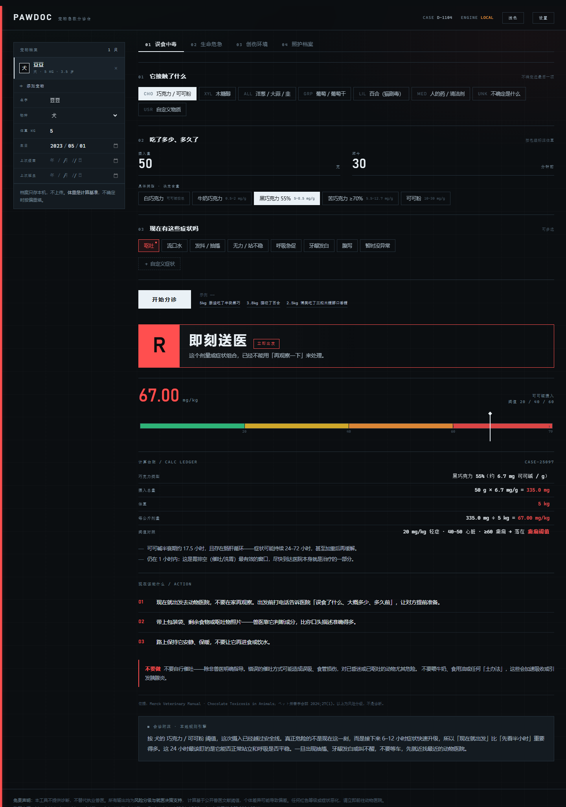
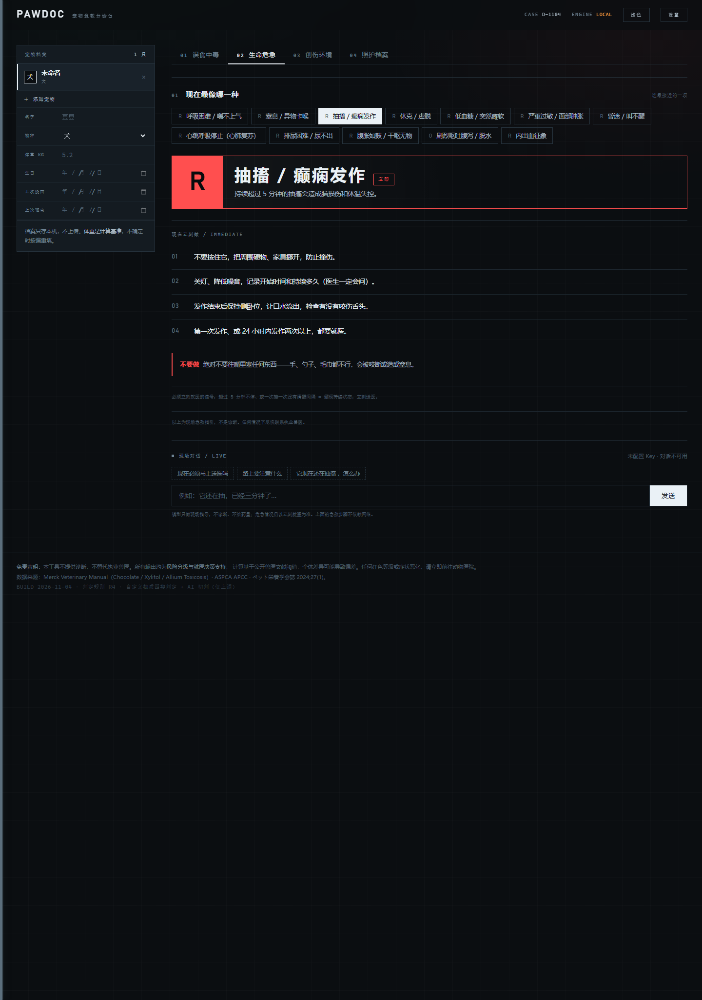

# 爪爪医生 PawDoc 🐾

> 宠物急救第一响应 + 全年照护管家
> 2026 软工菁英杯 · 初级组（大一）· 主题：**宠物**

## 这是什么

宠物发生误食、中毒等紧急情况时，主人通常只有两个选择：在搜索引擎里被「猫瘟」吓到，或者直接冲去医院。
**爪爪医生在 30 秒内回答三个问题**：要不要现在就去医院、为什么、路上该做什么。

产品不做诊断，只做**风险分级与就医决策支持**——这是一个明确的边界，也是我们的设计前提。

## 界面

**误食中毒 · 规则引擎算出剂量，给出四级风险**



**生命危急 · 12 类致命情况的现场处置**



## 项目简介

宠物误食、抽搐、外伤往往发生在深夜。主人第一反应是搜索，得到的却常是信息噪声——要么被「猫瘟」吓到，要么错过黄金抢救窗口。我们把这个场景拆成三个问题：**现在要不要送医、为什么、路上做什么**。

产品分三个模块：误食中毒覆盖巧克力、木糖醇、洋葱、葡萄、百合等常见毒物，按物种与体重算出每公斤摄入量，对照兽医文献阈值给出红橙黄绿四级结论；生命危急收录呼吸困难、窒息、抽搐、休克、低血糖、过敏、尿闭、胃扭转等 12 类；创伤环境收录出血、车祸、坠落、骨折、烧伤、中暑、溺水、触电、难产等 13 类。另有照护档案，管理多只宠物的疫苗、驱虫与体重曲线。

技术上有两个取舍。**一是剂量绝不交给模型**：所有数值由确定性规则引擎计算，界面展示完整算式，模型只负责解释，断网也能出结论。**二是自定义物质不让系统硬猜**：先查关键词，查不到就问用户「属于哪一类」，用七选一的封闭问题替代无限词表；未收录的才交给模型初判，且模型只能上调风险、不能下调。

## 四个模块

| 模块 | 输入 | 输出 |
|---|---|---|
| **01 误食中毒** | 物种、体重、误食物、摄入量、时间、症状 | 红/橙/黄/绿四级风险 + 剂量计算过程 + 三步行动 + 资料来源 |
| **02 生命危急** | 12 类随时致命的情况（呼吸困难、窒息、抽搐、休克、低血糖、过敏、昏迷、心肺复苏、尿闭、胃扭转、脱水、内出血） | 当场能做的 3–4 步 + 绝不能做的事 + 必须就医的信号 |
| **03 创伤环境** | 13 类外伤与环境急症（出血、车祸、坠落、骨折、烧伤、化学灼伤、中暑、溺水、触电、咬伤、眼外伤、难产、冻伤） | 同上，含固定、搬运、降温、止血的具体做法 |
| **04 照护档案** | 生日、疫苗、驱虫、体重 | 免疫与驱虫时间轴、逾期提醒、体重曲线 |

**支持 8 类物种**：犬、猫、兔、仓鼠/豚鼠/龙猫、鸟、龟/蜥蜴、雪貂、刺猬。
每种物种有独立的敏感度系数与特有风险提示（例如兔对催吐无反应、鸟对烟雾极敏感、猫张口呼吸即急症）。

**多宠物档案**：一个家庭可以建多个档案，左栏一键切换，疫苗/驱虫/体重曲线各自独立，数据只存本机。

**现场对话（02 / 03 栏目）**：两个急救栏目下方各有一个对话框，可以边做边问。
对话会自动带上上下文（物种、体重、当前选中的情况），流式返回，回答限制在 3 句以内、只讲下一步动作。
提示词里写死三条禁令：不给药名与剂量、不做诊断、不承诺「没事」；一旦描述里出现更危险的信号（抽搐不止、停止呼吸、大出血、意识丧失），第一句必须先要求立刻送医。

## 技术架构：为什么数字不让模型算

```
用户输入
   │
   ├─→ 【确定性规则引擎】index.html 内 evaluate()
   │      · 可可碱 mg/kg = 克数 × 含量 ÷ 体重
   │      · 木糖醇 g/kg、洋葱 g/kg 同法归一化
   │      · 症状加权：抽搐/昏迷/呼吸急促直接把等级拉到红色
   │      · 时间窗修正：>2h 提示胃排空窗口已过
   │      └→ 风险等级、剂量、阈值对照 —— 全部由代码产出
   │
   └─→ 【大模型 DeepSeek】只负责「解释」
          · 系统提示强制：不得计算、不得改写剂量、不得编造数值
          · 只允许基于传入的【已计算事实】补充「为什么」和「盯什么」
```

**这条分工是产品的技术核心。**

如果让模型自己算剂量，一旦算错，整条结论都不可信，而且无法解释、无法复现。
把数值计算锁死在确定性代码里，模型只做语言组织，就能保证：

- **可复现**——同样输入永远得到同样的等级
- **可解释**——界面上直接展示计算过程，评委/用户能自己核对
- **可降级**——模型挂掉时，分诊结论完全不受影响（见下）

## 降级设计（演示稳定性）

模型调用失败或未配置 Key 时，产品自动切换到**本地规则引擎话术**，四个风险等级各有一套预设的、与医学依据对应的说明文本。
顶栏状态灯会显示「本地规则引擎 · 离线可用」。

这意味着**断网也能完整演示**——答辩现场网络出问题时，产品不会崩。

## 自定义物质：三层兜底

知识库里没有的物质，按顺序走三层，越往后越依赖用户：

**第一层 · 关键词规则**（离线、确定性）
命中即定档：`木屑 → 惰性 → 居家观察`、`老鼠药 → 剧毒 → 即刻送医`、`丝袜 → 异物 → 电话咨询`。

**第二层 · 类别选择**（离线、确定性）★
词库没覆盖的，不让系统硬猜，而是问用户一个**封闭问题**：「它属于哪一类？」

| 类别 | 等级 | 关注点 |
|---|---|---|
| 正常食物 / 宠物食品 | 🟢 居家观察 | 吃多了会吐会软便 |
| 剩饭剩菜 / 人类零食 | 🟢 居家观察 | 高油高盐 → 胃肠炎、胰腺炎 |
| 植物 / 花草 | 🟡 电话咨询 | 多数是口腔刺激，少数致命 |
| 小物件（塑料/布/线/骨头） | 🟡 电话咨询 | 梗阻与肠道损伤 |
| 药品 / 保健品 | 🔴 即刻送医 | 治疗窗极窄，剂量不可推算 |
| 清洁剂 / 化学品 / 农药 | 🔴 即刻送医 | 腐蚀性，忌催吐 |
| 说不清 | 🟡 电话咨询 | 中间档 + 建议咨询 |

**这就是解决"词库永远不够"的办法**：主人一定知道那是剩饭还是洗洁精，只是原来没问。把开放的名词识别换成一个 7 选 1 的封闭问题，覆盖面从"我们认识多少词"变成"用户能分多细"。

**第三层 · 模型初判**（在线、仅作补充）
只有用户选了「说不清」时才调用 DeepSeek 做归类，返回 JSON。**模型只能上调等级，不能下调。**

| 规则判定 | AI 判定 | 最终 |
|---|---|---|
| 未收录（黄） | 剧毒 | 🔴 升红 |
| 未收录（黄） | 惰性 | 🟡 仍为黄 |
| 命中剧毒（红） | 任何 | 🔴 不动 |

理由：模型可能自信地把有毒的东西说成没事，这个方向的错误是致命的；反过来把无毒的说成有毒，只是多跑一趟医院。所以模型的自由度**只朝「更谨慎」开放**。

**规则永远优先于类别、类别优先于模型**：用户选了「正常食物」却写「老鼠药」，最终仍判红。

## 数据来源

所有阈值均来自公开兽医文献，界面上随结果一并展示：

| 物质 | 关键阈值 | 来源 |
|---|---|---|
| 巧克力（可可碱） | 20 mg/kg 轻症 · 40–50 心脏毒性 · ≥60 癫痫 | Merck Veterinary Manual, *Chocolate Toxicosis in Animals* |
| 巧克力可可碱含量 | 牛奶 0.5–2 · 黑巧55% 5–8.5 · ≥70% 5.5–12.7 · 可可粉 10–30（mg/g） | ペット栄養学会誌 2024;27(1) |
| 木糖醇 | >0.1 g/kg 低血糖 · >0.5 g/kg 肝损伤 | Merck Veterinary Manual, *Xylitol Toxicosis*；ASPCA APCC |
| 洋葱 / 大蒜 | 犬 15–30 g/kg · 猫 5 g/kg（大蒜毒性约为洋葱 3–5 倍） | Merck Veterinary Manual, *Allium spp Toxicosis* |
| 葡萄 / 葡萄干 | 无确立安全剂量；犬最低中毒量 19.6 / 2.8 g/kg | Merck Veterinary Manual；VetLearn 2013 |
| 百合 | 猫接触任一部位即急性肾衰，无安全剂量 | 兽医共识 |

## 运行

纯静态单文件，无构建、无依赖、无后端。

```bash
# 方式一：本地起个服务（推荐，避免 file:// 的跨域限制）
python -m http.server 8000
# 浏览器打开 http://127.0.0.1:8000

# 方式二：直接双击 index.html（模型调用可能因 file:// 跨域失败，分诊功能不受影响）
```

**配置模型**：点右上角「设置」，填入 DeepSeek API Key（`sk-...`），保存在本机 localStorage。
不填也能用——只是「医生助手补充建议」会走本地规则引擎。

> 注意：静态页面的 Key 在前端可见，比赛演示可用；正式上线必须改成后端代理。

## 测试

计算引擎有 18 条断言，覆盖四类毒物、四个风险等级和边界情况：

```bash
node test/engine.test.js
```

## 目录

```
.
├── index.html                  单文件应用（HTML + CSS + JS 全部内联）
├── test/engine.test.js         计算引擎 44 条断言
├── DESIGN.md                   设计系统：字体/颜色/间距/动效与改动守则
├── docs/                       界面截图
└── README.md
```

界面采用 **Emergency Dispatch Console（急救调度台）**：字母级风险牌 R/O/Y/G、会自动摆到读数的剂量量规、随等级变色的左缘电平条。
**全站颜色只用于表示风险，其余一律灰阶**。右上角可切换深色 / 浅色两套主题。
完整设计依据见 `DESIGN.md`。

## 团队与分工

4 人小组，中山大学软件工程学院 2026 级。分工见提交材料。

## 免责声明

本工具不提供诊断，不替代执业兽医。所有输出均为风险分级与就医决策支持，
计算基于公开兽医文献的阈值，个体差异可能导致结果偏差。
任何红色等级或症状恶化，请立即前往动物医院。
